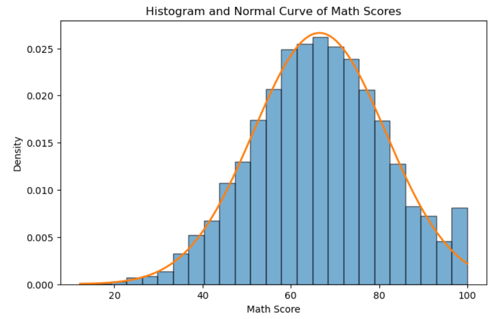
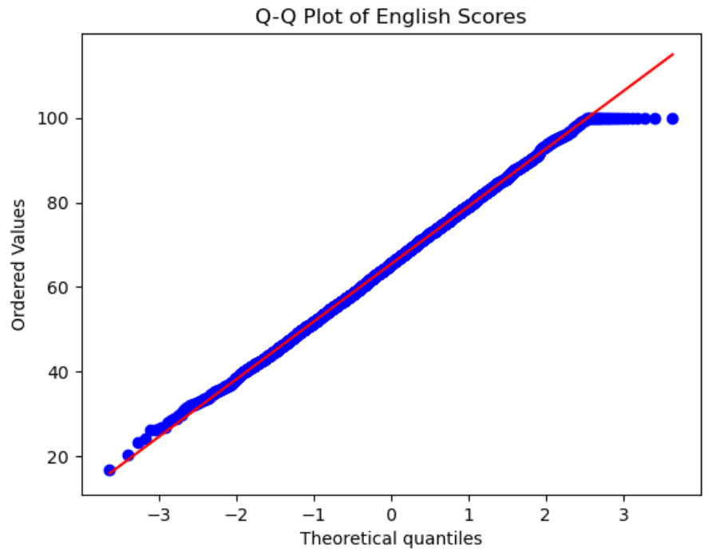
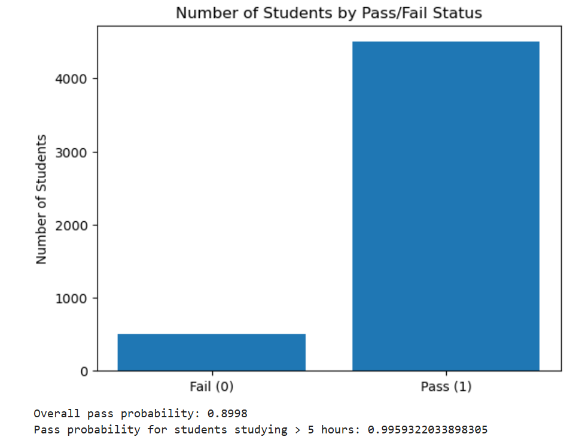

# Student Scores Analysis – Mini Research Project

## 📌 Project Overview

The **Student Scores Analysis** project is a Python-based mini research project that performs statistical analysis, probability calculations, data visualization, and basic linear algebra operations on a dataset containing **5,000 student records**.

The main objective of this project is to understand students' academic performance, analyze their study hours, calculate statistical measures, study score distributions, and examine the relationship between study hours and passing results.

This project is developed using Python in Jupyter Notebook with the help of libraries such as NumPy, Pandas, Matplotlib, Seaborn, and SciPy.

---

## 🎯 Project Objectives

The major objectives of this project are:

- To generate and analyze a dataset containing 5,000 student records.
- To calculate measures of central tendency and dispersion.
- To understand basic probability and conditional probability.
- To create a contingency table for Pass/Fail status and study hours.
- To visualize the distribution of Mathematics scores using a histogram and normal curve.
- To calculate skewness and kurtosis for Science scores.
- To perform a Q-Q Plot analysis of English scores.
- To perform basic linear algebra operations using student score vectors.
- To identify meaningful insights from the dataset.

---

## 📂 Dataset Description

The dataset used in this project is named **students_scores.csv** and contains 5,000 records with the following seven columns:

| Column Name | Description |
|---|---|
| Student_ID | Unique identification number of each student |
| Age | Age of the student |
| Math_Score | Marks obtained in Mathematics |
| Science_Score | Marks obtained in Science |
| English_Score | Marks obtained in English |
| Hours_Studied | Number of hours studied |
| Pass_Fail | Student result (0 = Fail, 1 = Pass) |

**Pass/Fail Condition:**

In this project, a student is considered to have passed if the average score of Mathematics, Science, and English is greater than or equal to 50.

---

## 🛠️ Technologies and Libraries Used

The following technologies and Python libraries are used:

| Technology / Library | Purpose |
|---|---|
| Python | Programming language |
| Jupyter Notebook | Writing and executing Python code |
| NumPy | Numerical calculations and vector operations |
| Pandas | Dataset creation and data analysis |
| Matplotlib | Creating graphs and visualizations |
| Seaborn | Data visualization support |
| SciPy | Statistical calculations and Q-Q Plot |

---

## 📊 Project Implementation

The practical implementation is divided into four major steps.

### Step 1: Measures of Central Tendency and Dispersion

In this step, statistical measures are calculated to understand the distribution and variation of student scores.

**For Math_Score:**
- Mean
- Median
- Mode

**For Science_Score:**
- Range
- Variance
- Standard Deviation

**Results:**

| Statistical Measure | Result |
|---|---:|
| Math Mean | 66.4890 |
| Math Median | 66.3000 |
| Math Mode | 100.0 |
| Science Range | 95.3 |
| Science Variance | 227.1459 |
| Science Standard Deviation | 15.0714 |

These measures help understand the average performance and variation in students' examination scores.

### Step 2: Probability Basics

This step focuses on calculating the probability of students passing and examining the relationship between study hours and passing results.

The following operations are performed:

1. **Probability of Passing:** Calculates the probability of selecting a student whose Pass_Fail value is 1.

2. **Contingency Table:** Creates a table between Pass_Fail and Hours_Studied greater than 5 hours.

3. **Conditional Probability:** Calculates the probability of passing given that a student studies more than 5 hours.

**Results:**

- Overall Probability of Passing: **89.98%**
- Conditional Probability of Passing when studying more than 5 hours: **99.59%**

These results indicate that students who studied more than 5 hours had a higher observed passing rate in this generated dataset.

### Step 3: Distribution and Visualization

This step focuses on understanding the distribution of students' marks through statistical analysis and graphical representation.

Three main statistical visualization tasks are performed.

#### 1. Histogram and Normal Curve of Math Scores

The histogram represents the frequency distribution of Mathematics scores, while the normal curve provides a reference for comparing the observed distribution with a normal distribution.

**Explanation:**
- The X-axis represents Mathematics scores.
- The Y-axis represents probability density.
- The bars represent the distribution of Mathematics scores.
- The curve represents the fitted normal distribution using the sample mean and standard deviation.

This graph helps understand the spread and overall shape of Mathematics scores.

#### 2. Skewness and Kurtosis of Science Scores

Skewness and kurtosis are calculated to understand the shape of the Science score distribution.

**Results:**
- Skewness: -0.1089
- Excess Kurtosis: -0.0702

**Explanation:**

Skewness measures the asymmetry of a distribution. A negative value indicates slight left skewness.

Kurtosis describes the heaviness of the tails compared with a normal distribution. The calculated excess kurtosis is slightly negative.

These measures help describe the distribution of Science scores.

#### 3. Q-Q Plot of English Scores

A Quantile-Quantile (Q-Q) Plot is created to compare the distribution of English scores with a theoretical normal distribution.

**Explanation:**
- The X-axis represents theoretical normal quantiles.
- The Y-axis represents sample quantiles of English scores.
- Points close to the reference line indicate approximate agreement with a normal distribution.
- Large deviations from the line indicate differences from normality.

This graph helps visually examine whether English scores approximately follow a normal distribution.

---

## 📊 Project Charts and Visualizations

All the charts generated during the project are displayed below with their explanations. These visualizations help understand the statistical analysis and academic performance of students.

### 1. Histogram and Normal Curve of Math Scores

This graph shows the distribution of Mathematics scores and compares the observed scores with a fitted normal distribution.



**Explanation:**
- The histogram represents the distribution of Mathematics scores.
- The normal curve represents a theoretical normal distribution based on the sample mean and standard deviation.
- It helps understand the spread and shape of Mathematics scores.

### 2. Q-Q Plot of English Scores

This graph compares the English score distribution with a theoretical normal distribution to visually examine normality.



**Explanation:**
- The X-axis represents theoretical normal quantiles.
- The Y-axis represents the sample quantiles of English scores.
- Points close to the reference line indicate approximate normality.
- Deviations from the line indicate differences from a normal distribution.

### 3. Pass/Fail Bar Chart

This graph compares the total number of students who passed and failed in the dataset.



**Explanation:**
- Fail (0) represents students who did not pass.
- Pass (1) represents students who passed.
- The height of each bar represents the number of students in that category.

This chart provides a clear comparison of the overall passing and failing students.

**Note:** All three charts are also available together in the `Student_Scores_Charts.pdf` file included in the repository.

---

### Step 4: Linear Algebra Mini Task

In this step, the Mathematics and Science scores of the first five students are represented as vectors.

**Math Score Vector:**

[79.7, 99.8, 81.6, 62.2, 52.1]

**Science Score Vector:**

[53, 96, 71, 71, 53]

The following mathematical operations are performed:

| Operation | Result |
|---|---:|
| Dot Product | 26776.0000 |
| L1 Norm of Math Vector | 375.4000 |
| L2 Norm of Math Vector | 171.9126 |
| Angle Between Vectors | 9.3441° |

**Explanation:**

- **Dot Product:** Calculates the sum of the products of corresponding vector elements.
- **L1 Norm:** Calculates the sum of the absolute values of vector elements.
- **L2 Norm:** Calculates the square root of the sum of squared vector elements.
- **Angle Between Vectors:** Measures the angle between the Mathematics and Science score vectors.

These operations demonstrate the application of linear algebra in Python.

---

## 💡 Key Findings and Insights

Based on the statistical calculations and visualizations, the following insights were identified:

1. Approximately **89.98%** of students passed in the generated dataset.

2. Approximately **99.59%** of students who studied more than 5 hours passed.

3. The average Mathematics score was **66.49**, while the median score was **66.30**.

4. The standard deviation of Science scores was approximately **15.07**, indicating the variation in students' Science marks.

5. The observed passing rate among students studying more than 5 hours was approximately 9.61 percentage points higher than the overall passing rate.

These findings describe the generated dataset and do not establish that studying longer directly causes students to pass.

---

## 📁 Project Folder Structure

The GitHub repository should be organized as follows:

```text
Student-Scores-Analysis/
│
├── Student_Scores_Mini_Research_Project.ipynb
│
├── students_scores.csv
│
├── Student_Scores_Mini_Research_Report.pdf
│
├── Student_Scores_Charts.pdf
│
├── images/
│   ├── math_histogram_normal_curve.png
│   ├── english_qq_plot.png
│   └── pass_fail_counts.png
│
└── README.md
```

---

## ⚙️ Installation and Requirements

To run this project, Python and Jupyter Notebook must be installed.

Install the required Python libraries using the following command:

```bash
pip install numpy pandas matplotlib seaborn scipy
```

### How to Run the Project

1. Download or clone this GitHub repository.
2. Open the project folder in Jupyter Notebook.
3. Open `Student_Scores_Mini_Research_Project.ipynb`.
4. Execute the notebook cells one by one from top to bottom.
5. The first code cell generates the dataset containing 5,000 student records.
6. Run all remaining cells to perform statistical calculations, probability analysis, visualization, and vector operations.
7. View the outputs and graphs generated by the notebook.

---

## 📌 Conclusion

The Student Scores Analysis project demonstrates the practical application of Python in statistical analysis, probability, data visualization, and linear algebra.

By analyzing 5,000 student records, the project provides an understanding of students' academic performance, score distributions, study hours, and passing results.

The project also demonstrates how Python libraries such as NumPy, Pandas, Matplotlib, Seaborn, and SciPy can be used to perform mathematical and statistical operations efficiently.

Overall, this mini research project provides practical experience in data analysis and helps develop a better understanding of statistical concepts through real-world-style dataset analysis.

---

## 👩‍💻 Project Information

**Project Name:** Student Scores Analysis – Mini Research Project

**Project Type:** Statistical Analysis and Python Programming

**Dataset:** students_scores.csv

**Dataset Size:** 5,000 Records

**Programming Language:** Python

**Platform:** Jupyter Notebook

**Project Category:** Data Analysis, Statistics, Probability and Visualization

---

⭐ **If you find this project useful, consider giving the repository a star!**
